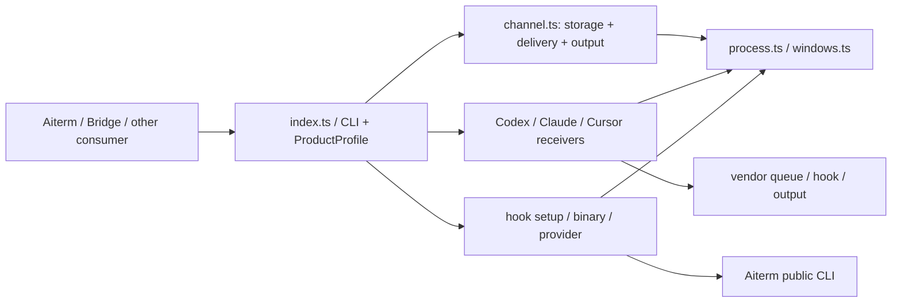

# Steer正式版の機能図

対象source base: `6734ee86a77928640877415fb83981475f7cb142` (正式0.5.1)。修理branch: `fix/process-probe-details-20261103`。図の来歴は受入候補f510bf6だが、channel責務は正式版の単一channel.tsへ対応させた。runtime refactorの統合ではない。現在の実file SHA・関数位置は[source-index](source-index.md)が正本。

- [channel](channel.md) / [図](channel.svg): 保存、競合、待機、出力。
- [vendor receiver図](steer-receivers.svg): 受付と表示、unknown保持。
- [setup/runtime/provider](steer-setup-runtime.md) / [図](steer-setup-runtime.svg): process本人性、設定、依存解決、外部窓口。
- [process公開失敗契約](process-diagnostics.md): 正式6734の基準動作と候補に実装した診断追加、caller、試験範囲。

Aitermとの接続は[正式0.63.6親配送caller](https://github.com/kitepon/aiterm-mcp/blob/v0.63.6/src/parent-delivery.ts)、[公開契約](https://github.com/kitepon/aiterm-mcp/blob/v0.63.6/README.md)を参照する。Aiterm内部refactor候補の稼働は仮定しない。BridgeのDB/予約/receipt、各Hostの更新はconsumer所有。
